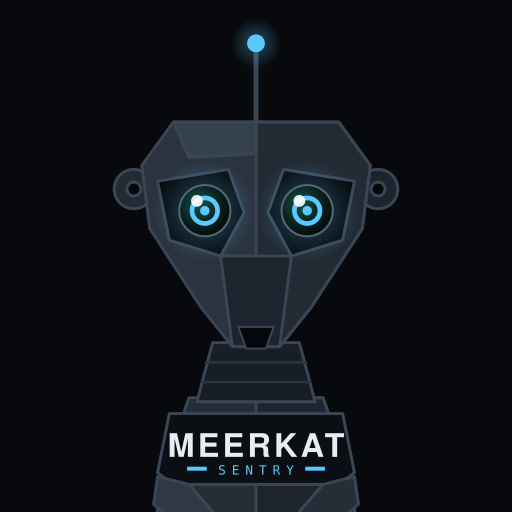
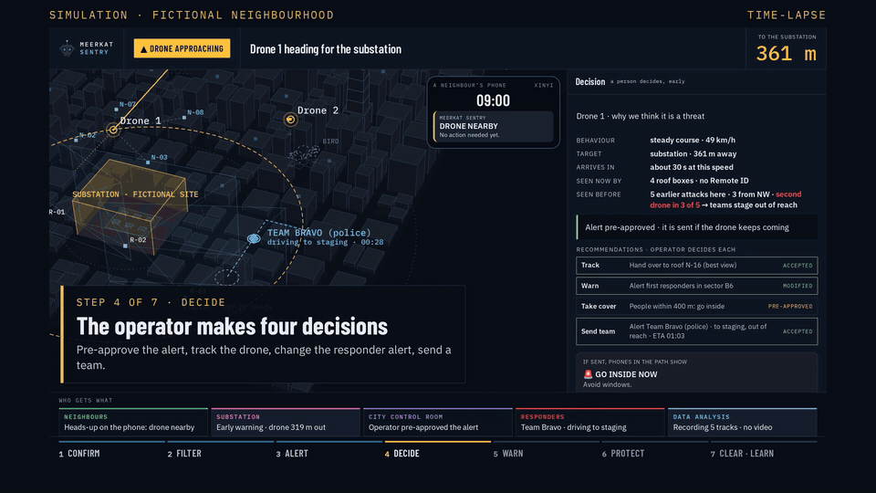

<p align="center"></p>

<h1 align="center">Meerkat Sentry</h1>
<p align="center"><b>Every roof keeps watch.</b></p>
<p align="center"><b>Honorable Mention</b> · Taiwan Defense Tech Hackathon (EDTH) · Taipei, 2–4 Oct 2026<br>Team 08 · Challenge 04: low-cost drone detection, tracking and response decision support</p>

<p align="center">
  <a href="https://janbarkemeyer.github.io/meerkat-sentry/media/video-1-real-test.mp4"><b>Video 1 · real outdoor test (33 s)</b></a> ·
  <a href="https://janbarkemeyer.github.io/meerkat-sentry/media/video-2-vision.mp4"><b>Video 2 · the vision, simulated (85 s)</b></a> ·
  <a href="media/meerkat-sentry-deck.pdf"><b>Deck (PDF)</b></a> ·
  <a href="https://janbarkemeyer.github.io/meerkat-sentry/demo/meerkat_vision.html"><b>Live demo</b></a> (laptop)
</p>


<p align="center"><sub>Simulation of the finished system in a fictional neighbourhood. What is real is listed below.</sub></p>

<p align="center"><sub>Camera nodes and fusion: Edoardo Dominikus, Sean Ching · Dashboard, simulation and videos: Jan Barkemeyer · Deck and strategy: Jan Barkemeyer, Robin Fischer · Pitch: Robin Fischer</sub></p>

## In one paragraph

Small drones fly below the roofs, where radar cannot see. Meerkat Sentry puts cheap camera boxes on many roofs. When at least three roofs see the same object, it is a confirmed drone (tested indoors; outdoors so far with one station). A person in the city control room checks the alert, and the approved alert goes to the authority that warns the public. Residents host the boxes, the city runs the network. We complement radar in the city. We warn people; we do not shoot drones down.

## The problem

Small drones already disrupt cities: Taoyuan airport stopped its runway in 2023 and 2026, European airports closed for hours in 2025, and drones flew over Kinmen outposts in 2022. The lesson from Ukraine: cheap drones hit power stations first, then the crews who come to repair them. In a city, those drones fly between buildings, below the radar’s line of sight.

<sub>Sources: Focus Taiwan (2023), Taipei Times (2026), Kyiv Independent and Wikipedia (2025), Jamestown Foundation (2022); full list on the last page of the deck.</sub>

## How it works

1. **Roof box.** 2–6 cheap cameras per roof, facing the sky. Each compares frames; changed pixels become a moving candidate. Video stays in the box; only detections leave it.
2. **Network.** 2 roofs give a 3D position, 3 confirm a drone. Birds, balls and drones that broadcast Remote ID are filtered before anyone sees them, unless they head for a protected site.
3. **City control room.** One alert with the reason: speed, heading, time to target. A person accepts, rejects or changes each recommendation (track, warn, take cover, send a team). Every decision is logged.
4. **Warning.** The approved alert goes to the warning authority, which warns people in the drone’s path by cell broadcast, like an earthquake alert. Our demo uses a Telegram group instead.

## What is real and what is not

| | Status |
|---|---|
| 3 Raspberry Pi camera nodes + a controller that fuses their views into one 3D track: 15–20 fps, 23 ms median from camera to fusion | **real**, lab |
| 20 of 20 indoor test flights detected | **real**, lab |
| Outdoor test, 4 Oct 2026: a camera sees the drone against the sky, an image check scores it, the operator confirms, the phone gets the alert ([Video 1](https://janbarkemeyer.github.io/meerkat-sentry/media/video-1-real-test.mp4)) | **real**, one station; outdoor fusion of 3 roofs not yet tested |
| Operator dashboard: alert rules, recommendations, accept / reject / modify, decision log with CSV export | **built** |
| Filters for birds, balls, Remote ID drones and objects on the ground | **built**, tested in the simulation and with recorded controller data |
| Phone alert through a Telegram demo group | **real**, demo channel only |
| City neighbourhood with 24 roof boxes, a second drone aimed at the responders, the all clear, simulated data analysis (no video) ([Video 2](https://janbarkemeyer.github.io/meerkat-sentry/media/video-2-vision.mp4)) | **simulation**, fictional site |
| Outdoor range, false-alarm rate, coverage between high-rises | **not yet measured**: the first job of a pilot |
| Night and fog: thermal camera + microphones in the same box | **future** |

## Who does what (target model)

| | Role | Gets |
|---|---|---|
| **Residents, building committees** | host a roof box (roof + power), free; can add their own box at cost | warnings for their block |
| **City / civil defence** (target buyer, not validated) | runs the network and the control room; pays for the base network and the service | a picture of drones below the radar, in everyday use and in a crisis |
| **Warning authority** (NCDR / Ministry of National Defense) | decides and sends the public warning | a confirmed track with the reason |
| **Military, radar operators** | — | tracks below the radar, as a complement |

One network, two uses: everyday (find illegal drone flights) and crisis (warn people in the drone’s path). Boxes at cost; we would earn on a service fee per box and month (maintenance, replacement, software, control room). Our cost is ≈ $8+ per box and month (assumption); the price would be set in a pilot. Video never leaves the box, data is never sold, and a person always approves a public warning.

**Numbers, with their basis:** one roof box costs ≈ $345 in off-the-shelf parts today (no core part made in the PRC); ≈ $100 is the target at volume (assumption). Taiwan’s urban areas would need ~78,000 boxes at one box per 250 m (assumption: spacing not yet measured). The drone detection market is ≈ $2.8 bn by 2030 (MarketsandMarkets).

## Try it

Open the [live demo](https://janbarkemeyer.github.io/meerkat-sentry/demo/meerkat_vision.html) on a laptop. It plays on its own; **Play demo** (bottom left) restarts it as a guided story. **H** shows the shortcuts, **W** switches to [what already works](https://janbarkemeyer.github.io/meerkat-sentry/demo/meerkat_today.html). Both are single HTML files that run offline: download one and double-click it.

## How it was built

- **Dashboard and simulation:** one HTML file in plain JavaScript, no framework; the 3D city is drawn on a canvas and everything runs offline.
- **Videos:** Video 1 is the real outdoor clip; we only added captions, zooms, a short slow motion and title cards. Video 2 is recorded frame by frame from the dashboard with Playwright and a paused clock (not a screen capture), cut with Python and ffmpeg; its music is generated in Python.
- **Camera nodes and fusion:** Raspberry Pi cameras and a Python / OpenCV controller (Edoardo Dominikus, Sean Ching).
- **Deck:** generated from Python and HTML, rendered to PDF and PowerPoint.

## Repository

```
index.html                 website: videos, how it works, team
demo/meerkat_vision.html   the city concept (simulation, guided demo)
demo/meerkat_today.html    the real lab system and its measurements
src/dashboard_src.html     source of both demo pages (plain HTML, CSS and JavaScript)
src/build.py               builds demo/ from the source: python3 src/build.py
src/fonts/                 the fonts embedded in the demo pages, with their licences
media/                     videos, screenshots, logo, deck (PDF)
```

The camera nodes and the fusion controller were built by Edoardo Dominikus and Sean Ching and are not in this repository. The dashboard reads the controller’s live feed and applies its own rules: a track counts as a drone only when 3 stations support it, and nothing below 1.4 m (a person) raises an alert.

## Team 08

| | |
|---|---|
| [Edoardo Dominikus](https://www.linkedin.com/in/edoardo-dominikus/), Sean Ching | camera nodes, fusion controller, outdoor test |
| [Jan Barkemeyer](https://www.linkedin.com/in/janbarkemeyer) | operator dashboard, city simulation, both videos, deck, strategy and business case; maintains this repository |
| [Robin Fischer](https://www.linkedin.com/in/robin-fischer-104627132/) | deck, strategy and business case, pitch on stage |

Built at the [Taiwan Defense Tech Hackathon](https://luma.com/tdth-2026) by EDTH, Taipei 2026. The jury rated originality and scalability highest.

---

© 2026 Team 08 Meerkat Sentry. All rights reserved. Shared for viewing; please ask before reusing.
